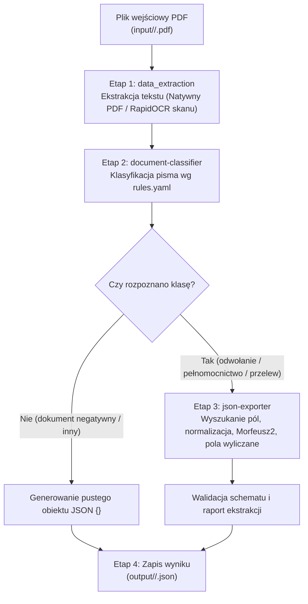

# odwolania2json

> **Od dokumentów do danych. Inteligentna transformacja dokumentów odwoławczych KIO do ustrukturyzowanego modelu JSON.**

Projekt realizuje automatyczną transformację wielodokumentowych spraw administracyjnych w postępowaniach odwoławczych przed **Krajową Izbą Odwoławczą (KIO)** przy **Urzędzie Zamówień Publicznych (UZP)** do ustrukturyzowanego, kanonicznego formatu JSON.

Rozwiązanie działa w **100% lokalnie (on-premise)**, nie wymaga karty graficznej (GPU) ani zewnętrznych płatnych usług chmurowych, zapewniając pełne bezpieczeństwo danych i zgodność z wymaganiami technicznymi konkursu.

---

## Spis treści

1. [Główne możliwości](#główne-możliwości)
2. [Sposób działania (Architektura potoku)](#sposób-działania-architektura-potoku)
3. [Wymagania systemowe](#wymagania-systemowe)
4. [Instalacja i pierwsze uruchomienie (Setup)](#instalacja-i-pierwsze-uruchomienie-setup)
   - [Automatyczny setup (Zalecane)](#automatyczny-setup-zalecane)
   - [Instalacja ręczna](#instalacja-ręczna)
5. [Instrukcja uruchomienia](#instrukcja-uruchomienia)
   - [Przetwarzanie wsadowe CLI](#przetwarzanie-wsadowe-cli)
   - [Interfejs graficzny Web GUI](#interfejs-graficzny-web-gui)
   - [Narzędzia pomocnicze venv](#narzędzia-pomocnicze-venv)
6. [Struktura katalogów i plików](#struktura-katalogów-i-plików)
7. [Konfiguracja i rozszerzalność (YAML)](#konfiguracja-i-rozszerzalność-yaml)
8. [Testy i metryka jakości F1-Score](#testy-i-metryka-jakości-f1-score)
9. [Transparentność i raportowanie](#transparentność-i-raportowanie)
10. [Rozwiązywanie problemów (FAQ)](#rozwiązywanie-problemów-faq)

---

## Główne możliwości

- **Hybrydowa ekstrakcja tekstu**: obsługa natywnych dokumentów cyfrowych PDF (poprzez `pypdfium2` / `Docling`) oraz skanów papierowych i faksów (silnik OCR `RapidOCR` + `onnxruntime` z automatycznym wykrywaniem skanu, prostowaniem i korektą kąta obrotu tekstu).
- **Klasyfikacja dokumentów**: bezbłędne rozpoznawanie typów pism (`odwolanie`, `pelnomocnictwo`, `przelew`) oraz precyzyjne odrzucanie dokumentów niepasujących / negatywnych (zwracających `{}`).
- **Deklaratywna ekstrakcja regułowa**: definicje pól, sekcji, wzorców wyrażeń regularnych i logiki biznesowej zawarte w plikach konfiguracyjnych YAML (`definitions/`) – brak konieczności zmian w kodzie Pythona przy rozszerzaniu systemu.
- **Normalizacja i lematyzacja języka polskiego**: standaryzacja formatów dat, kwot pieniężnych, numerów NIP, REGON, PESEL, KRS, numerów BZP/TED oraz lematyzacja nazwisk i form deklinacyjnych za pomocą biblioteki `morfeusz2`.
- **Wbudowany interfejs graficzny Web GUI**: aplikacja przeglądarkowa do podglądu PDF i wygenerowanych danych JSON obok siebie, z wizualną atrybucją (provenance) oraz wbudowanym edytorem reguł YAML w czasie rzeczywistym.
- **Zgodność ze strukturą wejścia/wyjścia**: automatyczne mapowanie hierarchii katalogów `input/<sprawa>/<plik>.pdf` → `output/<sprawa>/<plik>.json`.

---

## Sposób działania (Architektura potoku)

Dla każdego pliku PDF umieszczonego w katalogu `input/` aplikacja wykonuje sekwencyjnie 4-etapowy proces przetwarzania:



### 1. Ekstrakcja tekstu (`pipeline/data_extraction`)
- Skuteczna analiza warstwy tekstowej pliku PDF.
- Jeśli dokument nie posiada warstwy tekstowej lub składa się ze skanów niskiej jakości, uruchamiany jest potok OCR oparty na **RapidOCR** (ONNX).
- Moduł OCR dokonuje segmentacji linii, prostowania przekrzywionego tekstu (deskewing) i korekty orientacji stron.

### 2. Klasyfikacja dokumentu (`pipeline/document-classifier`)
- Klasyfikator bada zawartość wyekstrahowanego tekstu na podstawie reguł określonych w `pipeline/document-classifier/rules.yaml`.
- Analizuje wagi słów kluczowych, nagłówków, fraz charakterystycznych i wykluczeń.
- Dostępne klasy:
  - `odwolanie` – odwołanie do Prezesa Krajowej Izby Odwoławczej,
  - `pelnomocnictwo` – pełnomocnictwo procesowe do reprezentowania wykonawcy,
  - `przelew` – potwierdzenie uiszczenia wpisu od odwołania lub opłaty skarbowej,
  - `None` (dokument negatywny) – pisma niepodlegające ekstrakcji (np. wnioski dowodowe, pisma przewodnie, załączniki techniczne).

### 3. Ekstrakcja pól, normalizacja i pola wyliczane (`pipeline/json-exporter`)
- Na podstawie `definitions/field_definitions.yaml` lokalizowane są odpowiednie sekcje dokumentu (np. Odwołujący, Zamawiający, Pełnomocnik, Przedmiot zamówienia).
- Wartości są dopasowywane wzorcami regułowymi i kontekstowymi podpowiedziami (`hints`).
- **Normalizacja formatów** (`definitions/formats.yaml`):
  - Daty konwertowane do standardu ISO `YYYY-MM-DD` (obsługa miesięcy słownie w języku polskim, np. „15 marca 2026 r.”).
  - Kwoty walutowe przeliczane na liczby zmiennoprzecinkowe `float` (np. `1 200,50 zł` → `1200.5`).
  - Identyfikatory: NIP (usunięcie kresek/prefiksu PL), KRS (dopełnienie do 10 cyfr), BZP, TED.
  - Imiona i nazwiska: lematyzacja mianownika z wykorzystaniem słownika morfologicznego `morfeusz2` (np. „Jana Kowalskiego” → „Jan Kowalski”).
- **Pola wyliczane i powiązania** (`definitions/derivations.yaml`):
  - Uzupełnianie wartości domyślnych, relacji i sum na podstawie innych pól dokumentu.

### 4. Zapis wyniku do `output/`
- Wynikowy plik JSON jest zapisywany w identycznej ścieżce poddrzewa w katalogu `output/` (np. `input/case1/skan.pdf` → `output/case1/skan.json`).
- W przypadku dokumentu niesklasyfikowanego (negatywnego) lub błędu, tworzony jest poprawny pusty obiekt JSON (`{}`), zgodnie ze specyfikacją wyzwania.

---

## Wymagania systemowe

- **Python**: wersja **3.13+** (rekomendowana; system działa także na 3.10–3.15).
- **System operacyjny**: Windows 10/11, Linux (Ubuntu/Debian/Fedora) lub macOS.
- **Pamięć RAM**: minimum 4 GB (rekomendowane 8–16 GB dla dużych wielostronicowych skanów OCR).
- **Sprzęt**: procesor x86_64 / ARM64, **brak konieczności posiadania karty GPU**.
- **Dostęp do sieci**: wymagany wyłącznie podczas pierwszego pobierania pakietów przez `pip`. Całe działanie aplikacji odbywa się **offline / on-premise**.

---

## Instalacja i pierwsze uruchomienie (Setup)

Dla maksymalnej wygody przygotowano automatyczne skrypty tworzące dedykowane, izolowane środowisko wirtualne `.venv` i instalujące w nim wymagane zależności.

### Automatyczny setup (Zalecane)

#### System Windows:
Wystarczy dwukrotnie kliknąć lub uruchomić w wierszu poleceń:
```cmd
setup_venv.bat
```
*Opcjonalnie (zależności testowe do uruchomienia pytest):*
```cmd
setup_venv.bat --dev
```

#### System Linux / macOS:
Nadaj uprawnienia do wykonywania i uruchom skrypt instalacyjny:
```bash
chmod +x *.sh
./setup_venv.sh
```
*Opcjonalnie (zależności testowe):*
```bash
./setup_venv.sh --dev
```

**Co wykonuje skrypt instalacyjny?**
1. Wykrywa optymalny interpreter Pythona (wspiera `py -3.13`, `py -3`, `python3`, `python`).
2. Tworzy środowisko wirtualne w katalogu `.venv/`.
3. Aktualizuje menedżer pakietów `pip`.
4. Instaluje pakiety z pliku `requirements.txt` (m.in. `docling`, `rapidocr`, `morfeusz2`, `pydantic`, `pyyaml`, `pandas`, `pypdfium2`).

---

### Instalacja ręczna

Jeżeli preferujesz ręczną konfigurację w terminalu:

```bash
# 1. Klonowanie / przejście do folderu projektu
cd odwolania2json

# 2. Utworzenie wirtualnego środowiska
python -m venv .venv

# 3. Aktywacja środowiska
# Na Windows (cmd):
.venv\Scripts\activate.bat
# Na Windows (PowerShell):
.venv\Scripts\Activate.ps1
# Na Linux / macOS:
source .venv/bin/activate

# 4. Aktualizacja pip i instalacja zależności
pip install --upgrade pip
pip install -r requirements.txt

# (Opcjonalnie) instalacja narzędzi testowych
pip install -r requirements-dev.txt
```

---

## Instrukcja uruchomienia

### Przetwarzanie wsadowe CLI

Podstawowy tryb pracy aplikacji do masowego przetwarzania dokumentów PDF. Skrypty startowe **automatycznie wykrywają i używają utworzonego środowiska `.venv`**!

1. Umieść pliki PDF w katalogu `input/` (możesz organizować je w podfoldery, np. `input/sprawa_01/odwolanie.pdf`).
2. Uruchom przetwarzanie:

**Na Windows:**
```cmd
start.bat
```

**Na Linux / macOS:**
```bash
./start.sh
```

Wynikowe pliki JSON pojawią się w folderze `output/` z zachowaniem dokładnie tej samej struktury katalogów.

#### Zaawansowane parametry CLI
Możesz uruchomić główny program bezpośrednio przekazując dodatkowe parametry:

```cmd
# Uruchomienie ze szczegółowymi logami (-v)
start.bat -v

# Zapis dodatkowych raportów atrybucji (*.report.json)
start.bat --report-dir reports

# Bezpośrednio przez python w venv:
python main.py input output -v --report-dir reports
```

Dostępne parametry `main.py`:
- `input` – ścieżka do katalogu wejściowego (domyślnie `./input`).
- `output` – ścieżka do katalogu wyjściowego (domyślnie `./output`).
- `--report-dir KATALOG` – zapisuje szczegółowe raporty diagnostyczne i atrybucji dla każdego pliku (`<plik>.report.json`).
- `-v`, `--verbose` – włącza szczegółowe logowanie każdego kroku przetwarzania (OCR, klasyfikacja, dopasowanie reguł).

---

### Interfejs graficzny Web GUI

Projekt zawiera kompletny, nowoczesny interfejs graficzny uruchamiany w przeglądarce internetowej.

**Uruchomienie serwera GUI:**
- **Windows**: `start_gui.bat` (automatycznie uruchamia serwer i otwiera przeglądarkę)
- **Linux / macOS**: `./start_gui.sh` (następnie otwórz w przeglądarce adres `http://127.0.0.1:8765`)

Możesz także określić własny port:
```cmd
start_gui.bat 9000
```

#### Funkcje interfejsu GUI:
1. **Przesyłanie (Drag & Drop)**: przeciągnij jeden lub wiele plików PDF, aby natychmiast przetworzyć je w pamięci bez modyfikacji dysku.
2. **Przegląd i podgląd side-by-side**:
   - Po lewej stronie: interaktywny podgląd oryginalnego pliku PDF.
   - Po prawej stronie: sformatowany wynikowy model JSON.
   - **Wizualna atrybucja (provenance)**: kliknięcie w pole JSON podświetla fragment tekstu w dokumencie, z którego wartość została pobrana!
3. **Edytor konfiguracji YAML na żywo**:
   - Wbudowane zakładki do edycji plików: `field_definitions.yaml`, `formats.yaml`, `rules.yaml`, `derivations.yaml`, `lookups.yaml`.
   - Możliwość modyfikacji reguł w oknie przeglądarki i natychmiastowego ponownego przetestowania dokumentu.

---

### Narzędzia pomocnicze venv

Do repozytorium dołączono skrypty pozwalające na wygodne wywoływanie dowolnych poleceń wewnątrz środowiska `.venv`:

**Uruchomienie interaktywnej konsoli z aktywnym venv:**
- Windows: `run_venv.bat`
- Linux: `./run_venv.sh`

**Wykonanie konkretnego polecenia w środowisku:**
```cmd
# Windows:
run_venv.bat python -c "import morfeusz2; print('OK')"
run_venv.bat pytest

# Linux:
./run_venv.sh python -c "import morfeusz2; print('OK')"
./run_venv.sh pytest
```

---

## Struktura katalogów i plików

```text
odwolania2json/
├── definitions/                     # Deklaratywne reguły biznesowe w YAML
│   ├── documents.yaml               # Rejestr obsługiwanych klas dokumentów i plików wyjściowych
│   ├── field_definitions.yaml       # Definicje pól JSON, sekcji, etykiet i wzorców regex
│   ├── formats.yaml                 # Formaty wartości (daty, NIP, PESEL, kwoty, normalizacja)
│   ├── lookups.yaml                 # Słowniki wartości kanonicznych
│   └── derivations.yaml             # Reguły pól wyliczanych i wartości domyślnych
├── dev/                             # Przykładowe dane testowe i treningowe
│   └── dane/                        # Zbiór spraw (odwołania, pełnomocnictwa, skany, negatywne)
├── gui/                             # Interfejs graficzny użytkownika
│   └── index.html                   # Aplikacja Single Page Application (HTML5/JS/CSS)
├── pipeline/                        # Moduły potoku przetwarzania
│   ├── data_extraction/             # Ekstrakcja tekstu z PDF (pypdfium2 / RapidOCR / deskewing)
│   ├── document-classifier/         # Klasyfikator dokumentów oraz rules.yaml
│   └── json-exporter/               # Budowanie modelu JSON, conformer, ewaluacja reguł
├── tests/                           # Zestaw testów jednostkowych i ewaluacyjnych
│   ├── test_json_exporter.py        # Testy jednostkowe normalizacji i eksportera
│   ├── test_dev_f1score.py          # Ewaluacja F1-score na danych referencyjnych
│   ├── test_scans_f1score.py        # Ewaluacja jakości OCR na skanach
│   └── compare.py                   # Narzędzie CLI do porównywania JSON z referencją
├── wymagania/                       # Specyfikacja zadania i dokumentacja UZP
├── gui_server.py                    # Lokalny serwer HTTP obsługujący Web GUI i REST API
├── main.py                          # Punkt wejścia aplikacji CLI (wsadowe przetwarzanie input/output)
├── requirements.txt                 # Wymagane biblioteki produkcyjne
├── requirements-dev.txt             # Biblioteki deweloperskie i testowe (pytest, scikit-learn)
├── setup_venv.bat                   # Skrypt instalacji środowiska .venv (Windows)
├── setup_venv.sh                    # Skrypt instalacji środowiska .venv (Linux/macOS)
├── run_venv.bat                     # Skrypt uruchamiania poleceń w .venv (Windows)
├── run_venv.sh                      # Skrypt uruchamiania poleceń w .venv (Linux/macOS)
├── start.bat                        # Uruchomienie przetwarzania wsadowego CLI (Windows)
├── start.sh                         # Uruchomienie przetwarzania wsadowego CLI (Linux/macOS)
├── start_gui.bat                    # Uruchomienie serwera Web GUI (Windows)
├── start_gui.sh                     # Uruchomienie serwera Web GUI (Linux/macOS)
└── README.md                        # Niniejsza dokumentacja
```

---

## Konfiguracja i rozszerzalność (YAML)

Architektura systemu została zaprojektowana zgodnie z kryterium **pełnej elastyczności**: dodawanie nowych klas dokumentów oraz nowych pól odbywa się **wyłącznie deklaratywnie przez pliki YAML w `definitions/`**, bez ingerencji w kod źródłowy aplikacji.

### Jak dodać nowy typ dokumentu?
1. **Reguły klasyfikacji** (`pipeline/document-classifier/rules.yaml`): dodaj nową etykietę i słowa kluczowe:
   ```yaml
   nowy_dokument:
     keywords:
       - "wniosek o dopuszczenie"
       - "przystąpienie do postępowania"
     weight: 1.5
   ```
2. **Rejestracja klasy** (`definitions/documents.yaml`):
   ```yaml
   documents:
     nowy_dokument:
       output_file: nowy_dokument.json
       description: Wniosek o przystąpienie do postępowania
   ```
3. **Definicja schematu pól** (`definitions/field_definitions.yaml`):
   ```yaml
   nowy_dokument:
     sygnatura:
       type: string
       hints: ["sygn. akt", "sygnatura:"]
       capture: '\bKIO\s*\d+/\d{2}\b'
     data_zlozenia:
       type: string
       format: date
       hints: ["dnia", "data:"]
   ```

System natychmiast zacznie rozpoznawać nowy dokument i generować dla niego zgodny schemat JSON.

---

## Testy i metryka jakości F1-Score

Projekt zawiera automatyczne testy weryfikujące zgodność z danymi referencyjnymi przygotowanymi na bazie rzeczywistych spraw KIO:

```bash
# Uruchomienie testów jednostkowych eksportera
run_venv.bat pytest tests/test_json_exporter.py

# Uruchomienie ewaluacji F1-score na zbiorze dev (przykład 1-60)
run_venv.bat pytest tests/test_dev_f1score.py

# Uruchomienie ewaluacji jakości na skanach
run_venv.bat pytest tests/test_scans_f1score.py
```

### Porównywanie wyników pojedynczego pliku:
Możesz porównać wygenerowany plik z plikiem referencyjnym za pomocą narzędzia `compare.py`:
```cmd
run_venv.bat python tests/compare.py output/case1/odwolanie.json dev/dane/przyklad_01/odwolanie.json
```

---

## Transparentność i raportowanie

W procesach administracji publicznej kluczowa jest weryfikowalność podjętych decyzji. System `odwolania2json` zapewnia pełną przejrzystość:
- Przy uruchomieniu z flagą `--report-dir <katalog>` dla każdego pliku generowany jest raport `<plik>.report.json`.
- Raport zawiera:
  - źródło ekstrakcji (warstwa cyfrowa czy OCR),
  - liczbę stron, orientację, status OCR,
  - listę ewentualnych ostrzeżeń i uwag dotyczących walidacji formatów,
  - metadane dotyczące pewności rozpoznanych pól.
- W interfejsie Web GUI użytkownik może bezpośrednio kliknąć dowolne pole wynikowe, aby zobaczyć dokładny kontekst tekstowy w dokumencie źródłowym.

---

## Rozwiązywanie problemów (FAQ)

**P: System zgłasza błąd o braku biblioteki `morfeusz2` podczas instalacji pip na specyficznej wersji Pythona.**
O: Biblioteka `morfeusz2` posiada gotowe koła binarne (wheels) dla większości popularnych wersji Pythona na platformach Windows i Linux x86_64. W przypadku problemów upewnij się, że używasz 64-bitowego Pythona.

**P: Na systemie Linux skrypt `setup_venv.sh` nie chce się uruchomić.**
O: Upewnij się, że plik ma uprawnienia do wykonywania: `chmod +x *.sh`. Upewnij się także, że w systemie zainstalowano pakiet venv dla Twojej wersji Pythona (np. `sudo apt install python3-venv`).

**P: Wyjście w konsoli Windows wyświetla zniekształcone polskie znaki.**
O: Wszystkie skrypty `.bat` automatycznie ustawiają stronę kodową UTF-8 (`chcp 65001`). Upewnij się, że Twój terminal (np. Windows Terminal lub CMD) używa czcionki obsługującej polskie znaki diakrytyczne (np. Cascadia Code, Consolas).

---

*Rozwiązanie przygotowane na konkurs Urzędu Zamówień Publicznych: „Od dokumentów do danych. Inteligentna transformacja odwołań KIO do modelu JSON”.*